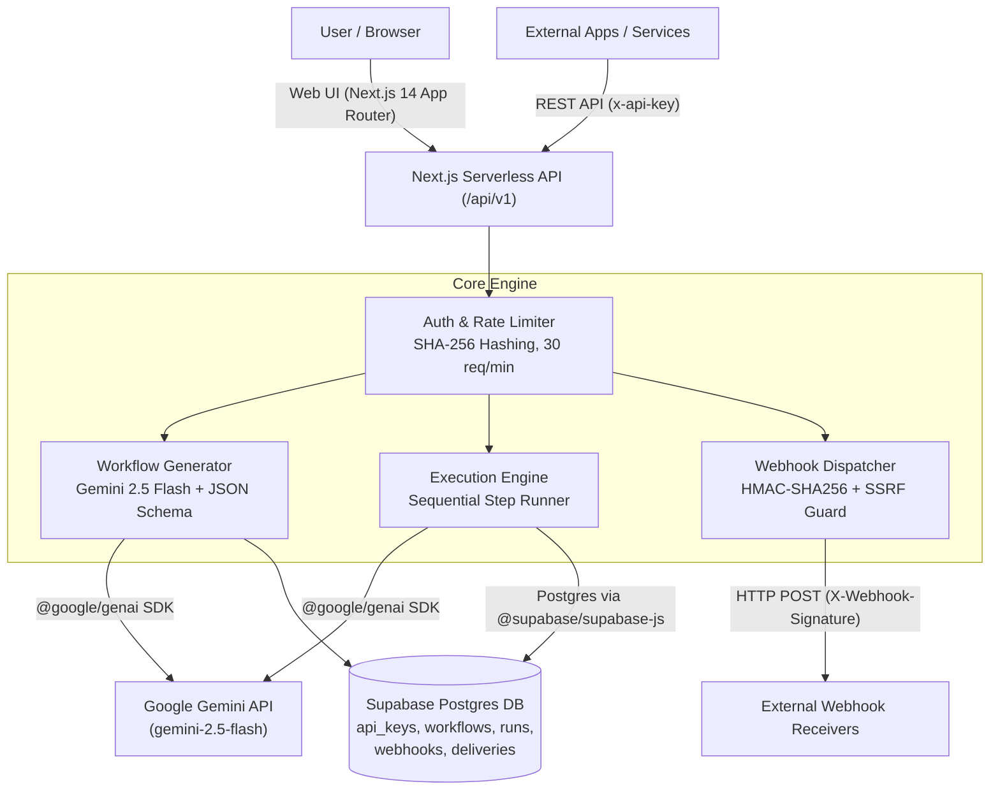

# Workflow Automation Assistant (GenAI Platform)

A university GenAI project that translates natural language business process descriptions into executable, multi-step workflows using the Gemini API. The system executes steps sequentially with Gemini, tracks step-by-step telemetry, provides a real-time web interface, supports a public REST API with HMAC-SHA256 webhooks, and deploys seamlessly to Vercel and Supabase.

---

## 1. System Architecture



---

## 2. Technology Stack (Free Tier)

- **Framework**: Next.js 14+ (App Router, TypeScript)
- **Styling**: Tailwind CSS
- **AI SDK**: Official `@google/genai` SDK (server-side only, direct integration)
- **AI Model**: `gemini-2.5-flash` with structured JSON schema output
- **Database**: Supabase Postgres (free tier) via `@supabase/supabase-js` (service-role key on server only)
- **Validation**: Zod schema validation
- **Documentation**: OpenAPI 3.0 specification (`/api/openapi.json`) and Swagger UI (`/docs`)
- **Security**: SHA-256 API key hashing, HMAC-SHA256 webhook signatures, SSRF protection, in-memory rate limiting, HTTP-only admin cookies

---

## 3. Environment Variables

Create `.env.local` based on `.env.example`:

| Variable | Description | Default / Example |
| :--- | :--- | :--- |
| `GEMINI_API_KEY` | Google Gemini API key from Google AI Studio | `AIzaSy...` |
| `GEMINI_MODEL` | Gemini model name | `gemini-2.5-flash` |
| `SUPABASE_URL` | Supabase Postgres project URL | `https://xyz.supabase.co` |
| `SUPABASE_SERVICE_ROLE_KEY` | Supabase secret service role key (server only) | `eyJhbGci...` |
| `ADMIN_PASSWORD` | Password for web UI dashboard and API key access | `admin123` |
| `APP_URL` | Base application URL | `http://localhost:3000` |

> **Security Note**: Never commit `.env` or `.env.local`. Git is configured to ignore all `.env*` files except `.env.example`.

---

## 4. Setup Instructions

### A. How to Get a Free Gemini API Key from Google AI Studio
1. Visit [Google AI Studio](https://aistudio.google.com/).
2. Sign in with your Google account.
3. Click **Get API key** in the left sidebar.
4. Click **Create API key** (select an existing Google Cloud project or create a free default project).
5. Copy the generated key and assign it to `GEMINI_API_KEY` in your `.env.local` file.

### B. How to Set Up Supabase
1. Sign up for free at [supabase.com](https://supabase.com/).
2. Create a new project (e.g., `workflow-automation-assistant`).
3. Open the **SQL Editor** tab in your Supabase dashboard.
4. Copy the entire contents of `supabase/schema.sql` from this repository and run it in the editor.
5. In your Supabase project settings, navigate to **Project Settings > API**:
   - Copy **Project URL** into `SUPABASE_URL`.
   - Copy **service_role (secret)** into `SUPABASE_SERVICE_ROLE_KEY`.

### C. Local Installation & Development
```bash
# 1. Clone repository and install dependencies
npm install

# 2. Configure environment
cp .env.example .env.local

# 3. Start local development server
npm run dev
```
Open [http://localhost:3000](http://localhost:3000) to view the dashboard and UI.

---

## 5. Deployment on Vercel

1. Push your repository to GitHub or GitLab.
2. Visit [vercel.com](https://vercel.com/) and click **Add New Project**.
3. Import the repository.
4. In the **Environment Variables** section, configure:
   - `GEMINI_API_KEY`
   - `GEMINI_MODEL` (`gemini-2.5-flash`)
   - `SUPABASE_URL`
   - `SUPABASE_SERVICE_ROLE_KEY`
   - `ADMIN_PASSWORD`
   - `APP_URL` (`https://your-project.vercel.app`)
5. Click **Deploy**. Vercel will build and deploy the Next.js serverless application.

---

## 6. Built-in Workflow Templates

The system includes 4 built-in, 1-click industry templates:
1. **Customer Support Ticket Triage**: Classifies ticket sentiment and category, assesses urgency priority, extracts customer entities, drafts an empathetic support response, and evaluates escalation rules.
2. **HR Employee Onboarding**: Extracts new hire information, summarizes terms and schedule, prioritizes IT access provisioning, and drafts an executive welcome email.
3. **Meeting Notes -> Action Items + Follow-up Email**: Summarizes meeting transcripts, extracts action items with owners and deadlines, ranks priorities, and drafts follow-up recaps.
4. **Lead Qualification & Sales Outreach**: Extracts prospect parameters, classifies buying intent, calculates lead score (Hot/Warm/Cold), determines enterprise routing, and drafts personalized outreach.

---

## 7. Public REST API Reference & cURL Examples

All REST API endpoints are located under `/api/v1` and require the `x-api-key` header (except `/health`).

### 1. Health Check (Public)
```bash
curl -X GET http://localhost:3000/api/v1/health
```

### 2. Generate API Key
```bash
curl -X POST http://localhost:3000/api/v1/api-keys \
  -H "Content-Type: application/json" \
  -H "x-api-key: wfa_live_00000000000000000000000000000000" \
  -d '{"name": "Production Service Key"}'
```

### 3. Generate Workflow from Prompt
```bash
curl -X POST http://localhost:3000/api/v1/workflows/generate \
  -H "Content-Type: application/json" \
  -H "x-api-key: YOUR_API_KEY" \
  -d '{
    "prompt": "When a customer submits a support ticket, classify the sentiment, assess priority, extract order id, and draft an empathetic response.",
    "save": true
  }'
```

### 4. List Workflows (Paginated)
```bash
curl -X GET "http://localhost:3000/api/v1/workflows?limit=10&offset=0" \
  -H "x-api-key: YOUR_API_KEY"
```

### 5. Get Workflow Details
```bash
curl -X GET http://localhost:3000/api/v1/workflows/WORKFLOW_ID \
  -H "x-api-key: YOUR_API_KEY"
```

### 6. Delete Workflow
```bash
curl -X DELETE http://localhost:3000/api/v1/workflows/WORKFLOW_ID \
  -H "x-api-key: YOUR_API_KEY"
```

### 7. Trigger Workflow Execution Run
```bash
curl -X POST http://localhost:3000/api/v1/workflows/WORKFLOW_ID/run?sync=true \
  -H "Content-Type: application/json" \
  -H "x-api-key: YOUR_API_KEY" \
  -d '{
    "input": {
      "text": "Customer: Alice Baker. Order #9482. Credit card was billed twice. Please refund immediately."
    }
  }'
```

### 8. Inspect Run Details and Step Results
```bash
curl -X GET http://localhost:3000/api/v1/runs/RUN_ID \
  -H "x-api-key: YOUR_API_KEY"
```

### 9. List Execution Runs (Filter by Status)
```bash
curl -X GET "http://localhost:3000/api/v1/runs?status=completed&limit=20" \
  -H "x-api-key: YOUR_API_KEY"
```

### 10. Register Webhook
```bash
curl -X POST http://localhost:3000/api/v1/webhooks \
  -H "Content-Type: application/json" \
  -H "x-api-key: YOUR_API_KEY" \
  -d '{
    "url": "https://your-domain.com/webhook",
    "events": ["run.started", "run.completed", "run.failed"]
  }'
```

### 11. Send Test Webhook Ping
```bash
curl -X POST http://localhost:3000/api/v1/webhooks/WEBHOOK_ID/test \
  -H "x-api-key: YOUR_API_KEY"
```

---

## 8. Webhook Verification Example (Node.js)

When receiving webhook events, verify the `X-Webhook-Signature` header:

```javascript
const crypto = require("crypto");

function verifyWebhookSignature(secret, rawBodyString, signatureHeader) {
  if (!signatureHeader || !signatureHeader.startsWith("sha256=")) {
    return false;
  }

  const expectedSignature =
    "sha256=" + crypto.createHmac("sha256", secret).update(rawBodyString).digest("hex");

  const sigBuffer = Buffer.from(signatureHeader);
  const expectedBuffer = Buffer.from(expectedSignature);

  if (sigBuffer.length !== expectedBuffer.length) {
    return false;
  }

  return crypto.timingSafeEqual(sigBuffer, expectedBuffer);
}
```

A standalone receiver is provided at `examples/webhook-receiver.js`:
```bash
WEBHOOK_SECRET=whsec_your_secret PORT=4000 node examples/webhook-receiver.js
```

---

## 9. Automated Testing

Run the end-to-end smoke test suite:
```bash
./scripts/smoke-test.sh
```
